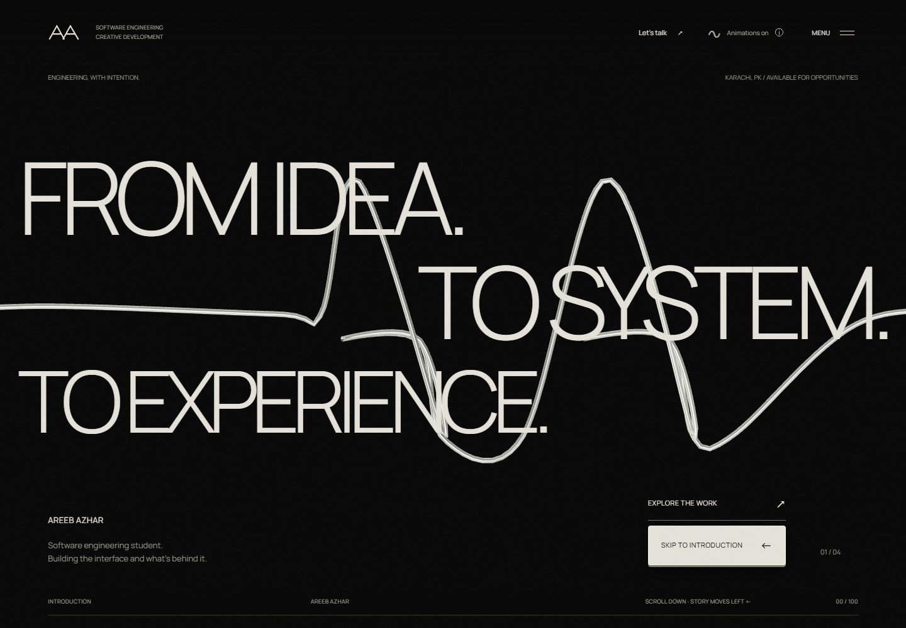
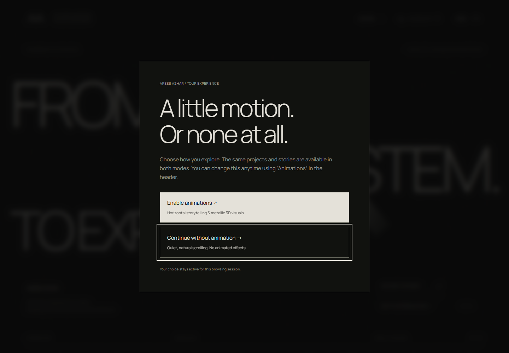
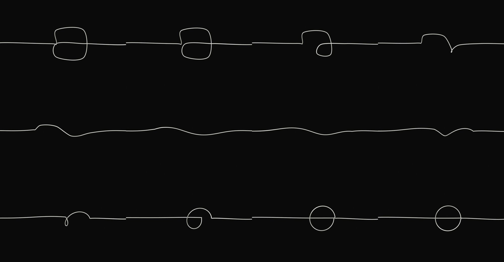
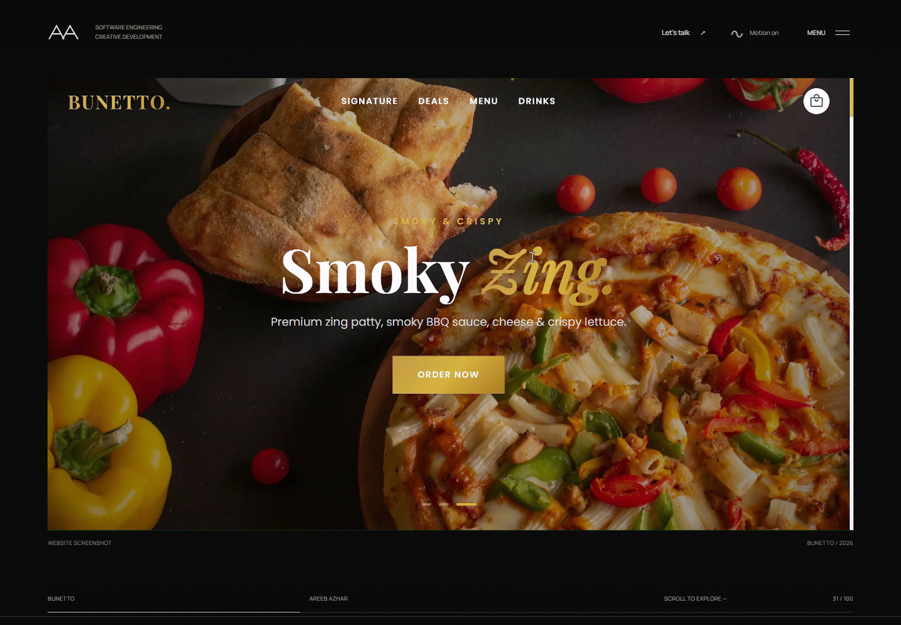

# Areeb Azhar — Engineering & Creative Development

A cinematic software engineering portfolio with an original metallic AA sculpture, native-scroll horizontal storytelling, and real project briefings. Built with semantic HTML, CSS, JavaScript, Vite, and Three.js.

**[Visit the portfolio](https://areeb-azhar.github.io/Portfolio/)** · **[GitHub](https://github.com/AREEB-AZHAR)** · **[Contact](mailto:areebazhar3@gmail.com)**



## The redesign

- **Latest update:** a gently eased, layered **right-to-left** desktop story connects **14 scenes, including the complete footer**. Native scroll input remains immediate, with no opening hold or reload entrance animation. Mobile uses natural **bottom-to-top** scrolling instead of a horizontal track.
- **Living-string correction:** the line itself now unwinds, travels, and gathers into each next drawing with scroll. The SVG fallback and metallic 3D wire use **the same open curve**, attached beyond both screen edges. Geometry is updated vertex-by-vertex; the object no longer floats or rotates as a substitute for deformation. Travelling highlights and small local tension waves keep the string alive at rest.
- **Skip to introduction** is a raised, filled button with hover/press/focus states. Clicking it smoothly glides to the next section on desktop and mobile; reduced-motion mode, refresh restoration, and keyboard focus remain immediate.
- Native cross-document View Transitions connect project titles and linework to their briefing pages, while keeping the header anchored. Other page changes share the same lateral visual language (vertical on mobile). Navigation begins immediately; wheel, touch, or keyboard input can interrupt a handoff. Unsupported browsers use regular links.
- Project screenshots and artwork appear inside their briefing pages, not on the homepage or project index. The landing showcase uses oversized titles, project stacks, and original line illustrations.
- A first-visit animation chooser explains both modes. The always-visible **Animations on/off** control includes a keyboard-accessible information label. The choice is retained across refreshes and navigation for the current browsing session.
- Optional WebGL setup waits until after consent and scroll idle; only visible sculptures initialize. The initial page and scrolling never wait for the 3D bundle. Shader compilation completes asynchronously before the sculpture appears.
- The shared footer now displays the complete **AREEB AZHAR** wordmark.
- A near-black and warm-ivory visual system with self-hosted Manrope typography.
- An original procedural metallic AA strand with precomputed studio reflections; the same mesh continues through the full homepage. Supporting pages retain their AA identity sculpture.
- Geometric transformations follow the same eased story position on desktop and the document’s natural section progression on mobile.
- Six expansive, typography-led project showcases with distinct line illustrations; real project media lives in the briefings.
- **24 static pages:** Home, About/Approach, Projects, Capabilities, Contact, and **19 canonical project briefings**.
- An opaque full-screen navigation menu with keyboard focus management, Escape dismissal, and scroll restoration.
- A searchable archive, direct project URLs, browser Back support, and next-project navigation.
- The latest four-year education/building history and GitHub profile identity, retained on the About page.
- Session-persistent motion preferences, system reduced-motion support, a static SVG fallback, and offscreen rendering suspension.

The visual direction is inspired by [Mohamed Elgazzar’s portfolio](https://www.thisisgazzar.com/en). The AA identity, geometry, wording, project information, and implementation belong to this portfolio; the reference’s branding and assets are not included.





The [local behavior test report](docs/verification/living-wire-results.json) records the intro glide positions, rendered pixel differences, idle motion, refresh response, and mobile checks. It does not claim deployment verification.

## Explore the work

| Project             | Engineering focus                                                      | Source                                                              |
| ------------------- | ---------------------------------------------------------------------- | ------------------------------------------------------------------- |
| RustBot             | Rust server, chatbot knowledge matching, browser UI, and external APIs | [Repository](https://github.com/AREEB-AZHAR/RustBot)                |
| Tally               | Flutter finance ledger, SQLite, analytics, Firebase integration        | [Repository](https://github.com/AREEB-AZHAR/flutter_calculator_new) |
| GraviPop            | Rust game loop, physics, rendering, and cross-platform input           | [Repository](https://github.com/AREEB-AZHAR/gravipop-mobile)        |
| Degree Verification | Hyperledger Fabric, credential issuance, and public verification       | [Repository](https://github.com/AREEB-AZHAR/Degree-blockchain)      |
| CryptoTrader        | Live market data, caching, local state, and simulated trading          | [Repository](https://github.com/AREEB-AZHAR/CryptoDashboard)        |
| Bunetto             | Ecommerce presentation, configurable cart, and WhatsApp order handoff  | [Repository](https://github.com/AREEB-AZHAR/Bunetto)                |

The archive retains Unity work, ChainShield, a trading-bot foundation, coursework, freelance Shopify work, cryptography experiments, indicators, AI game agents, architecture tooling, and personal web experiments. Earlier names and supporting work resolve to their canonical project and relevant section.

Project pages distinguish application screenshots, icons, supporting artwork, and conceptual diagrams. GraviPop and Bunetto use the supplied gameplay and website captures. Local-only work remains discoverable without invented repository links or production claims.



## Internship certificate

The About page includes the actual [completion certificate](public/certificates/rust-internship-areeb-azhar.pdf) for the **nine-week hybrid internship in Blockchain Technology and Rust Programming**, jointly delivered by **Hazara University, Mansehra, and Rockstable**, awarded in **September 2026**. RustBot’s briefing explains the associated backend, API, and frontend work.

## Run locally

### Prerequisites

- **Node.js 24.x**, as specified in `package.json`; install the matching Node release with npm included.
- Git and a modern browser. WebGL is optional: the site has an SVG fallback.
- No API keys, database, SDK, JDK, or `.env` file are required.

```bash
git clone https://github.com/AREEB-AZHAR/Portfolio.git
cd Portfolio
npm ci
npm run dev
```

Open the URL printed by Vite, normally `http://localhost:5173/`. The predev command generates all pages automatically. If a port is occupied, Vite prints the alternative port it selected.

### Build and preview

For a domain-root deployment, including Vercel:

```bash
npm run build
npm run preview
```

For GitHub Pages under `/Portfolio/`:

```bash
npm run build:pages
npm run preview -- --base=/Portfolio/
```

Open the printed preview URL, including `/Portfolio/` for the Pages build. Both builds generate `dist/`. Their prebuild hooks regenerate pages and validate the project content before bundling.

## Architecture

```text
src/
  content/projects.mjs     Project records, case-study content, capabilities
  sculpture.js             Procedural Three.js scenes and rendering lifecycle
  horizontal.js            Native vertical-scroll to negative-X story mapping
  thread.js                Animated SVG fallback using the live shared curve
  living-strand.mjs        Shared curve sampler: release, flow, gather, tension
  continuous-sculpture.js  Fixed-camera 3D wire and travelling energy shader
  strand-geometry.mjs      Dynamic open-tube vertices and normals
  page-transitions.mjs     Early native page-handoff and shared-title setup
scripts/
  generate.mjs             Shared templates and static HTML generation
  check-content.mjs        Content, route, related-link, and media validation
  check-strand.mjs         Real deformation, endpoint, continuity and buffer checks
  verify-browser.mjs       Browser regression checks and screenshot capture
  verify-horizontal.mjs    Desktop scenes, mobile flow, startup, page-handoff QA
  verify-living-wire.mjs   Pixel-level scroll deformation and smooth-button QA
  bake-studio.mjs          Optional offline studio reflection precomputation
public/
  projects/                Original screenshots and project artwork
  certificates/            Actual internship PDF and preview
  fonts/                   Self-hosted Manrope files and SIL Open Font License
  lighting/                Precomputed studio reflections; no runtime PMREM bake
docs/screenshots/           Real screenshots of the redesigned portfolio
main.js                    Menu, scrolling, motion controls, search, email composer
style.css                  Shared visual system and responsive layouts
vite.config.js             Multi-page entries and split 3D bundle
```

`scripts/generate.mjs` renders the shared header, navigation, footer, and page templates into real HTML entry points. Vite then produces static files, so project links work when opened directly or refreshed without an SPA rewrite rule.

The generated `about/`, `projects/`, `capabilities/`, and `contact/` source folders are ignored by Git. They are recreated by the npm scripts. The root `index.html` is generated too and retained in the repository as the landing-page entry. **Edit the manifest or templates, not generated HTML.**

### Update a project

1. Edit its record in `src/content/projects.mjs`. Each project has a stable slug, context, stack, challenge, implementation, decisions, outcome, and workflow.
2. Put real media in `public/projects/`, and set its path, alternative text, and media kind in the record. Preserve the difference between artwork and an actual interface capture.
3. Add optional sections for earlier versions, supporting tools, or related source repositories. Keep claims grounded in the project itself.
4. Run `npm run generate`, `npm test`, and the relevant production build. The generator adds the project to the index and produces `/projects/<slug>/` automatically.

Six records are marked `featured`; those appear in the homepage story. Capabilities link to project slugs in the same manifest. Update the image dimension map in `scripts/generate.mjs` when adding imagery to preserve reserved layout space.

## Interaction and accessibility

- The base HTML contains the content and navigation; animation progressively enhances it.
- Before animation consent, the page uses the static SVG and does not initialize WebGL. Three.js loads in a separate bundle after an idle interval; rendering pauses offscreen and in background tabs, pixel density is capped, and touch layouts use a lighter scene cadence. Studio reflections are baked from the original Three.js RoomEnvironment once, avoiding synchronous reflection generation in each visitor’s browser.
- Native document scrolling drives a **right-to-left** desktop track with a short frame-rate-independent presentation ease, layered title/linework depth, and a final full-name footer scene. The document itself is never smoothed or wheel-intercepted. Clicked section shortcuts glide with native smooth scrolling; refresh restoration and keyboard-focus jumps remain immediate. Left advances and Right returns to the previous scene. Supporting pages keep editorial content vertical and join a matching right-to-left footer finale. Below 768px, all sections and footers remain naturally vertical.
- Early, inline `pageswap`/`pagereveal` listeners enable native multi-page transitions without a render-blocking script request or a client-side router. Project titles and geometry become shared elements. Reloads do not run a handoff, reduced-motion mode skips it, and browser Back restores the original scene.
- The animation chooser appears once per tab session. Its choice survives refreshes and internal navigation through `sessionStorage`; a new session asks again. The device’s reduced-motion setting recommends the static option, and Escape chooses it. Without JavaScript, the content remains a regular readable page.
- Turning animations off restores the vertical document and stops GPU rendering. Turning them on preserves the current scene. The header button always states its status, and its information label appears on hover or keyboard focus.
- Native modal navigation provides focus containment. Closing restores focus and document scrolling.
- The contact form validates locally and opens a **mailto draft**. It does not transmit a message or claim that an email was sent; the visitor reviews and sends it in their email application.
- Images reserve their dimensions, retain their aspect ratios, and load lazily. Fonts are served locally.

## Verification

```bash
npm test
```

This regenerates the site and checks unique routes, required content, asset existence, HTTPS source links, related-project references, and the six featured records. The wire check validates fixed offscreen endpoints, actual vertex deformation, reversible poses, finite buffers, and continuity for small scroll steps across three aspect ratios. Both prebuild hooks include it.

The optional browser suite checks all 24 routes and their internal resources, five viewport widths, menu dismissal/focus/scroll restoration, archive filtering, project refresh/Back/Next behavior, certificate access, motion persistence, and WebGL fallback. It also captures screenshots.

To run it with your own Chromium installation:

```bash
npm install --no-save --package-lock=false playwright
npx playwright install chromium
# Start npm run dev in another terminal, then:
node scripts/verify-browser.mjs http://localhost:5173/
node scripts/verify-horizontal.mjs http://localhost:5173/
node scripts/verify-living-wire.mjs http://localhost:5173/
```

Use the actual server port if Vite selected a different one. For a Pages preview, supply its complete base URL, for example `http://localhost:4173/Portfolio/`. Screenshots go to ignored `tmp/qa/` (general suite) or `tmp/horizontal-qa/` (horizontal suite). `SCREENSHOT_DIR` changes that location, `BROWSER_CHANNEL=msedge` selects installed Edge, and `PLAYWRIGHT_MODULE` can point to an existing Playwright package. `QA_LIGHT=1` runs the alternate-build layout checks at 390px and 1440px while retaining route and resource checks.

The focused living-wire suite takes **12 actual rendered frames during small wheel scrolls**, with page text hidden to isolate the wire. It compares pixel changes, checks that scroll-driven deformation exceeds idle motion, verifies the SVG path changes, and writes a motion contact sheet plus `results.json`. It also samples the intro button’s intermediate scroll positions, checks its filled/raised appearance, and exercises mobile SVG fallback and smooth skipping. It needs the optional `sharp` package (`npm install --no-save --package-lock=false playwright sharp`); `SHARP_MODULE` can point to an existing installation. These are local behavior tests, not deployment-status checks.

The broader cinematic suite retains layout, navigation, and reduced-motion checks. Set `QA_SHORT=1` for short phones, or `QA_LANDSCAPE=1` for compact desktop heights. Timing output is a local smoke-test measurement, not a universal performance guarantee.

### Rebuild studio lighting (optional)

The precomputed lighting asset is committed; ordinary setup and deployment do **not** require Playwright or an asset bake. Only regenerate it after intentionally changing the studio environment or compatible Three.js texture layout. With the dev server running and the optional browser-test prerequisites installed:

```bash
node scripts/bake-studio.mjs http://localhost:5173/scripts/studio-bake.html
```

This writes `public/lighting/studio.cubeuv.bin.gz`: a gzip-compressed, little-endian width/height header followed by RGBA half-float CubeUV pixels. Runtime loading handles both raw gzip bytes and hosts that transparently decode gzip. Rebuild and visually verify the sculpture after regenerating it.

## Deployment

**Vercel:** `vercel.json` runs `npm ci` and `npm run build`, serves `dist/`, and uses Node.js 24.x from `package.json`. Import the repository with its root as the project root. Real static page directories provide nested URLs without a catch-all rewrite.

**GitHub Pages:** pushes to `main` trigger `.github/workflows/deploy.yml`. It installs locked dependencies, runs `npm run build:pages`, uploads `dist/`, and deploys to Pages. Asset URLs use `/Portfolio/`; internal navigation and certificate links remain relative to the current deployment.

For a release, validate content, build both variants, run the browser checks against the built files, and then commit and push. To roll back, revert the release commit and let the same workflow publish the previous version.

## Credits and contact

Manrope is distributed under the [SIL Open Font License](public/fonts/OFL.txt). Project screenshots and the internship certificate were supplied for this portfolio. The sculpture and line illustrations are generated in code.

**Areeb Azhar** · Karachi, Pakistan · [areebazhar3@gmail.com](mailto:areebazhar3@gmail.com)
